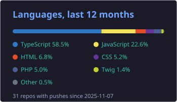

<!-- =========================================================
     OSAMA AYUB | GITHUB PROFILE README
     Theme: Midnight Navy + Electric Blue + Violet + Cyan
========================================================== -->

<div align="center">


<br/>


<br/><br/>


<br/><br/>

<a href="https://www.linkedin.com/in/osama-ayub8889993755979/">
  
</a>
&nbsp;
<a href="https://osama-ayubpersonal.vercel.app/">
  
</a>
&nbsp;
<a href="https://github.com/osamaayub">
  
</a>

<br/><br/>


<br/><br/>


</div>

---

## 👨‍💻 About Me

I'm a **Full-Stack Software Engineer** who builds web applications with **TypeScript, Next.js and Node.js**, and adds practical AI features to them: chat with your documents (RAG), streaming assistants and structured AI output. I work across the stack, from responsive interfaces to APIs, PostgreSQL and MongoDB databases, authentication, testing and deployment.

I enjoy turning ideas into practical software with clean code, thoughtful architecture, and a strong focus on user experience.

- 🌍 **Availability:** Open to remote Full-Stack Software Engineer opportunities worldwide
- ⚛️ **Frontend:** TypeScript, React 19, Next.js 16 (App Router, Server Components, Server Actions), Tailwind CSS, Redux Toolkit
- ⚙️ **Backend:** Node.js, Express.js, REST APIs, Next.js Route Handlers
- 🗄️ **Databases:** PostgreSQL, Drizzle ORM, MongoDB, Mongoose, MySQL
- 🤖 **AI Integration:** RAG with citations, OpenAI API, Anthropic Claude API, Vercel AI SDK, Google Gemini API, Vapi AI
- 🔐 **Authentication:** Auth.js (GitHub and Google sign-in), JWT, RBAC, Clerk
- 🧪 **Quality:** Zod validation, Vitest, GitHub Actions CI
- ☁️ **Cloud & Deployment:** Vercel, Netlify, AWS S3, Docker
- 🧰 **Tools:** Git, GitHub, Postman, AI coding agents (Claude Code)
- 🎯 **Engineering Focus:** Clean code, API design, performance, and maintainable architecture

---

## 🧑‍💻 Developer Profile

```ts
const osama = {
  name: "Osama Ayub",
  role: "Full-Stack Software Engineer",
  location: "Lahore, Pakistan",
  availability: "Open to Remote Opportunities",
  portfolio: "https://osama-ayubpersonal.vercel.app/",

  languages: ["TypeScript", "JavaScript", "SQL", "HTML", "CSS"],

  frontend: ["React 19", "Next.js 16", "Server Actions", "Tailwind CSS", "Redux Toolkit"],
  backend: ["Node.js", "Express.js", "REST APIs", "Route Handlers"],
  databases: ["PostgreSQL", "Drizzle ORM", "MongoDB", "Mongoose", "MySQL"],
  authentication: ["Auth.js", "JWT", "RBAC", "Clerk"],
  ai: ["RAG", "OpenAI API", "Claude API", "Vercel AI SDK", "Gemini API", "Vapi AI"],
  quality: ["Zod", "Vitest", "GitHub Actions"],
  cloudAndTools: ["Vercel", "Netlify", "AWS S3", "Docker", "Git", "Postman"],

  currentlyLearning: ["Agentic engineering with AI coding agents"],
  nextUp: ["Python + FastAPI", "LangGraph agents", "pgvector RAG", "LLM evals"],
};
```

---

## 🛠️ Tech Stack

### Languages

<p>
  
</p>

### Frontend Development

<p>
  
</p>

### Backend Development

<p>
  
</p>

### Databases

<p>
  
</p>

### Cloud, Deployment & Tools

<p>
  
</p>

### AI Integration

<p>
  
  
  
  
  
</p>

**Also:** Drizzle ORM · Auth.js · Zod · Vitest · Mongoose · JWT · RBAC · Clerk · Vapi AI

---

## 🚀 Featured Projects

### 01. Pulse: Admin Dashboard on Real PostgreSQL

**An admin dashboard for an online store: KPIs, charts, orders, customers and products.**

`Next.js 16` `TypeScript` `PostgreSQL` `Drizzle ORM` `Server Actions` `Zod` `Vitest` `Netlify`

- KPIs compared with the previous period, revenue charts and product performance.
- Orders you can search, filter, export to CSV, ship and refund, all in SQL on the server.
- Customers with lifetime value and full order history.
- Real PostgreSQL on Netlify, a health check, and a demo store that resets itself every day.

<p>
  <a href="https://github.com/osamaayub/pulse-dashboard">
    
  </a>
  <a href="https://pulse-dashboard-nextjs.netlify.app">
    
  </a>
</p>

---

### 02. DocChat: Chat With Your PDF (RAG)

**Upload a PDF, ask a question, and get a short answer with the page it came from.**

`Next.js 16` `TypeScript` `RAG` `OpenAI` `Claude API` `Zod`

- Retrieval-augmented generation: the answer comes only from the document.
- Every answer cites its page, and it says "I don't know" when the answer isn't there.
- Works with OpenAI or Anthropic Claude.

<p>
  <a href="https://github.com/osamaayub/pdf-chat-ai">
    
  </a>
  <a href="https://pdf-chat-ai-neon.vercel.app">
    
  </a>
</p>

---

### 03. AI Support Chatbot

**A streaming AI support chatbot with Next.js 16 and the Vercel AI SDK.**

`Next.js 16` `TypeScript` `Vercel AI SDK` `OpenAI` `GitHub Actions`

- Answers stream in word by word.
- Runs in demo mode without an API key, so anyone can try it.
- Feature-first architecture, tests and CI.

<p>
  <a href="https://github.com/osamaayub/nextjs-ai-chatbot">
    
  </a>
  <a href="https://nextjs-ai-chatbot-three-kappa-qi5cfa7xvl.vercel.app">
    
  </a>
</p>

---

### 04. BriefAI: AI SaaS Starter

**Turns messy meeting notes into a short summary and a clear list of action items.**

`Next.js 16` `TypeScript` `Drizzle ORM` `OpenAI structured output` `Server Actions`

- Structured AI output validated with Zod.
- Usage limits enforced on the server with a database transaction.

<p>
  <a href="https://github.com/osamaayub/briefai">
    
  </a>
</p>

---

### 05. WebDev Path: Free Learning Platform

**A free 24-week web development course platform.**

`Next.js 16` `TypeScript` `PostgreSQL` `Auth.js`

- Sign in with GitHub or Google, saved progress and quizzes graded on the server.

<p>
  <a href="https://github.com/osamaayub/webdev-path-lms">
    
  </a>
  <a href="https://webdev-path-lms.vercel.app">
    
  </a>
</p>

---

### 06. DevFlow

**A developer-focused Q&A platform built with modern Next.js architecture** (built following the JS Mastery course).

`Next.js` `React` `TypeScript` `MongoDB` `NextAuth` `Tailwind CSS` `Zod`

- Developer-focused question-and-answer experience.
- Authentication and user account workflows.
- Server Actions and data-driven application features.
- Structured validation with Zod.
- Search, tags, profiles, and community features.
- Maintainable application structure.

<p>
  <a href="https://github.com/osamaayub/DevFlow">
    
  </a>
  <a href="https://dev-flow-kappa-seven.vercel.app/">
    
  </a>
</p>

---

### 07. Equigenix / EquiJudge

**A platform for Arabian horse judge training, testing, invitations, and performance evaluation.**

`React` `TypeScript` `Node.js` `Express` `MongoDB` `AWS`

- Developed frontend and backend application features.
- Built and integrated REST APIs.
- Worked with role-based workflows for administrators, organizers, and judges.
- Implemented data filtering, pagination, and evaluation workflows.
- Worked with MongoDB schemas, queries, and aggregation.
- Integrated AWS S3 for file and media management.
- Troubleshot application issues and improved maintainability.

<p>
  <a href="https://app.staging.equijudge.ai/">
    
  </a>
</p>

---

### More Projects

| Project | What it is | Stack |
|---|---|---|
| AI Interview Preparation | Voice-based AI interview practice with feedback | Next.js, TypeScript, Firebase, Vapi AI, Gemini |
| JobLane | Job portal for job seekers and employers | React, Node.js, Express, MongoDB |
| Clinic Lead Management | Leads, appointments, treatments and inventory | React, Node.js, Express, MongoDB |
| [3D Developer Portfolio](https://github.com/osamaayub/3D-Developer-Portfolio) | Interactive portfolio with 3D scenes ([live](https://osamaayubportfoliowebsite.netlify.app/)) | React, TypeScript, Three.js, Framer Motion |

---

## 💼 Professional Experience

### Software Engineer — SensViz

**July 2025 – July 2026 · Lahore, Pakistan**

Worked on full-stack web applications using React, TypeScript, Node.js, Express, and MongoDB.

- Developed and maintained frontend features and reusable React components.
- Built and integrated REST APIs for application workflows.
- Implemented role-based workflows and access-control features.
- Worked with MongoDB schemas, queries, and aggregation.
- Developed data-driven interfaces with filtering and pagination.
- Contributed to testing, invitations, and evaluation workflows.
- Integrated AWS S3 for file and media management.
- Troubleshot application issues and improved code maintainability.

**Technologies:** `React` `TypeScript` `Node.js` `Express` `MongoDB` `AWS` `Git`

---

### Associate Software Engineer — Cogilent Solutions

**February 2025 – January 2026 · Islamabad, Pakistan**

- Developed web application features using React and Next.js.
- Built responsive interfaces and dashboard components.
- Integrated REST APIs and backend services.
- Worked with authentication and authorization workflows.
- Improved frontend performance using code splitting and lazy loading.
- Contributed to collaborative development workflows.

**Technologies:** `React` `Next.js` `TypeScript` `Clerk`

---

### MERN Stack Developer Intern — IIFATECH

**August 2024 – October 2024**

- Developed a full-stack job board using the MERN stack.
- Built REST APIs using Node.js and Express.
- Implemented JWT authentication.
- Designed MongoDB data models.
- Created responsive React interfaces.

**Technologies:** `React` `Node.js` `Express` `MongoDB` `JWT`

---

## 📊 Engineering Toolkit

| Area | Technologies |
|---|---|
| Languages | TypeScript, JavaScript, SQL, HTML, CSS |
| Frontend | React 19, Next.js 16, Tailwind CSS, Redux Toolkit, Material UI |
| Backend | Node.js, Express.js, REST APIs, Server Actions |
| Databases | PostgreSQL, Drizzle ORM, MongoDB, Mongoose, MySQL |
| Authentication | Auth.js, JWT, RBAC, Clerk |
| AI Integration | RAG, OpenAI API, Claude API, Vercel AI SDK, Gemini API, Vapi AI |
| Quality | Zod, Vitest, GitHub Actions |
| Cloud & Deployment | Vercel, Netlify, AWS S3, Docker |
| Tools | Git, GitHub, Postman, AI coding agents |

---

## 📈 GitHub Statistics

<div align="center">




<br/>



<br/><br/>


<sub>Cards update every day. "Last 12 months" shows what I write now; "all repos" includes older HTML and JavaScript projects.</sub>

</div>

---

## 🌱 Currently Learning

<div align="center">


</div>

- **Now:** agentic engineering with AI coding agents: context engineering, MCP, tools, planning, testing and code review (JS Mastery).
- **Next:** Python and FastAPI, LangGraph agents with tool calling, RAG on PostgreSQL with pgvector, and evals for AI answers.

---

## 🎯 What I Bring to a Team

- **Full-stack mindset:** Comfortable working across frontend interfaces, APIs, and databases.
- **Maintainable code:** Focused on readable, reusable, and well-structured implementations.
- **Product thinking:** Interested in solving real problems rather than adding unnecessary complexity.
- **Continuous learning:** Actively strengthening backend engineering, system design, and AI integration skills.
- **Remote collaboration:** Comfortable with Git-based workflows, clear updates, and asynchronous communication.

---

## 🤝 Let's Connect

<div align="center">


<br/><br/>

**I'm open to remote Full-Stack Software Engineer opportunities worldwide.**

Interested in building SaaS products, developer tools, AI-powered applications, dashboards, and scalable web platforms.

<br/>

<a href="https://www.linkedin.com/in/osama-ayub8889993755979/">
  
</a>
&nbsp;
<a href="https://osama-ayubpersonal.vercel.app/">
  
</a>
&nbsp;
<a href="https://github.com/osamaayub">
  
</a>

</div>

---

<div align="center">

### 💡 Build. Learn. Improve. Repeat.


</div>
